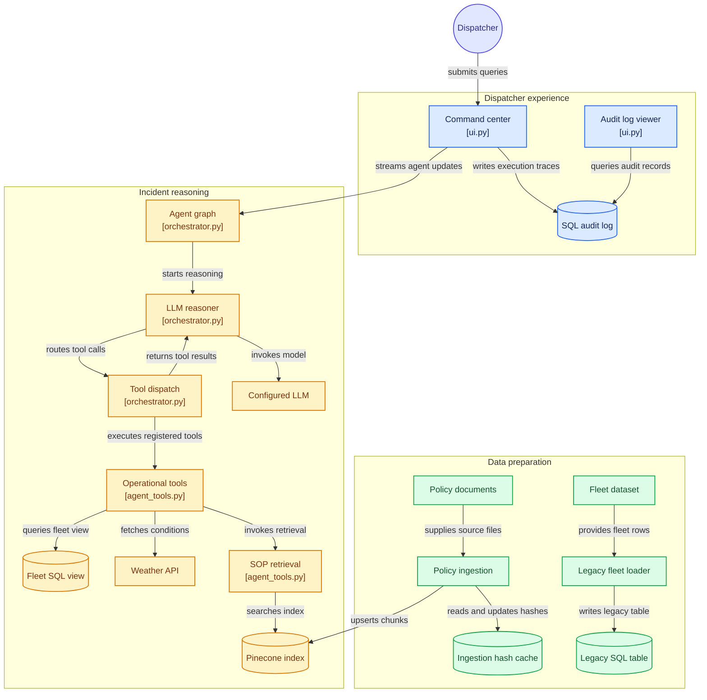

# Cold-Chain Logistics AI Assistant

An AI-powered logistics operations assistant that helps dispatchers investigate cold-chain incidents, monitor fleet telemetry, assess external corridor conditions, and retrieve operational procedures through natural language.

The application combines **LangGraph agent orchestration, Microsoft SQL Server telemetry, live weather data, and retrieval-augmented generation (RAG)** to turn operational data into actionable incident assessments.

## Architecture



### High-level workflow

1. A dispatcher submits a natural-language question through the Streamlit interface.
2. The LangGraph reasoner interprets the request and decides which tools to invoke.
3. The agent retrieves fleet telemetry from SQL Server, obtains current corridor weather from Open-Meteo, and searches operational SOPs in Pinecone as required.
4. Tool results are returned to the reasoner for analysis.
5. The assistant produces an operational response with relevant telemetry, risk assessment, and recommended actions.
6. Agent execution events are recorded in the SQL audit log for inspection.

## Key capabilities

- **Fleet telemetry analysis:** Query fleet GPS coordinates, cargo temperature, cargo condition, risk classification, delay probability, port congestion, and route-risk indicators.
- **Live corridor conditions:** Retrieve current weather conditions for specified GPS coordinates using Open-Meteo.
- **Policy-aware RAG:** Search indexed standard operating procedures for temperature thresholds, incident mitigation, diversion rules, and escalation criteria.
- **Agentic orchestration:** Use LangGraph to route between the LLM reasoner and external tools in a tool-calling loop.
- **Database access controls:** Expose a semantic SQL view to the agent instead of granting direct access to the raw legacy telemetry table.
- **Execution audit trail:** Record agent nodes, tool executions, session identifiers, and generated content, with a separate interface for inspecting audit records.
- **Configurable models:** Select a supported LLM provider and choose OpenAI or local Hugging Face embeddings for SOP retrieval.

## Technology stack

| Layer | Technologies |
|---|---|
| User interface | Streamlit |
| Agent orchestration | LangGraph |
| LLM integration | LangChain, LangChain OpenAI, Groq API, Ollama |
| Operational database | Microsoft SQL Server 2022 |
| Database integration | SQLAlchemy, pyodbc, Microsoft ODBC Driver 18 |
| RAG / vector database | Pinecone |
| Embeddings | BAAI/bge-m3 (default local model), OpenAI Embeddings |
| Document processing | PyPDF, Pandas, LangChain text splitters |
| External data | Open-Meteo API |
| Configuration | Python dotenv |
| Runtime | Python 3.12 |

## Repository structure

```text
cold-chain-logistics-AI-Assistant/
├── data/
│   ├── cache/
│   │   └── ingestion_hash_cache.json
│   ├── policy/
│   │   └── Cold_Chain_Incident_SOP_v2.md
│   ├── raw/
│   │   └── dynamic_supply_chain_logistics_dataset.csv
│   └── source/
│       └── data.txt
├── docs/
│   └── instructions.md
├── scripts/
│   ├── ingest_legacy_data.py
│   ├── ingest_sop_pinecone.py
│   └── setup_security_and_view.sql
├── src/
│   ├── prompts/
│   │   └── system_prompt.txt
│   ├── agent_tools.py
│   ├── orchestrator.py
│   └── ui.py
├── Misc/
│   └── Materials/
├── requirements.txt
└── README.md
```

## How it works

### 1. Fleet telemetry — Microsoft SQL Server

The supplied logistics dataset is loaded into SQL Server as a legacy-style table:

`dbo.TBL_SC_FLEET_HIST_RAW`

The SQL security script creates a semantic view:

`FDE_VIEWS.VW_ACTIVE_FLEET`

The view maps legacy column names into meaningful fields:

| View column | Description |
|---|---|
| Timestamp | Telemetry timestamp |
| Latitude / Longitude | Vehicle GPS coordinates |
| Current_Temperature_C | Current cargo temperature |
| Cargo_Condition_Code | Cargo condition indicator |
| Risk_Classification | Operational risk classification |
| Delay_Probability | Predicted delay probability |
| Port_Congestion_Level | Port congestion indicator |
| Route_Risk_Index | Route risk indicator |

The agent's database tool is designed to query this view using a restricted SQL login. The raw legacy table is denied to that login.

### 2. Corridor conditions — Open-Meteo

The `fetch_corridor_conditions` tool accepts latitude and longitude and retrieves current weather information from Open-Meteo.

The current implementation extracts external temperature and wind speed, then calculates a simple illustrative corridor-risk indicator based on wind speed.

> The congestion indicator is a heuristic in the current implementation, not a measured traffic or port-congestion feed.

### 3. SOP retrieval — Pinecone

Operational documents are ingested into Pinecone and retrieved using semantic similarity.

The ingestion pipeline supports:

- Markdown (`.md`)
- Text (`.txt`)
- PDF (`.pdf`)
- CSV (`.csv`)
- Excel (`.xlsx`)

Documents are split into chunks, enriched with source metadata, embedded, and upserted into Pinecone. An MD5-based local hash cache avoids re-ingesting unchanged files.

The default local embedding model is `BAAI/bge-m3`. OpenAI embeddings can also be selected through configuration. Separate Pinecone indexes are used for the two embedding configurations.

### 4. Agent orchestration — LangGraph

The agent is implemented as a LangGraph state machine with two primary nodes:

- **Reasoner:** Invokes the configured LLM with the available tools.
- **Tools:** Executes requested tool calls and returns their results to the reasoner.

The graph uses conditional tool routing and loops back to the reasoner after tool execution. A `MemorySaver` checkpointer maintains conversation state by thread ID during the process lifetime.

The system prompt defines the operational analysis workflow and expected response structure:

1. Executive Summary
2. Telemetry & Environment Analysis
3. Required Action Plan

### 5. User interface and audit trail

The Streamlit application provides two modes:

- **Dispatch Console:** Chat with the logistics assistant and inspect tool inputs and outputs.
- **Security & Audit Logs:** Authenticate with administrator credentials and inspect recorded agent execution events.

The UI assigns a thread ID to each workspace session and streams graph updates while the agent is running.

## Getting started

### Prerequisites

- Python 3.12
- Docker
- Microsoft SQL Server 2022 container
- Microsoft ODBC Driver 18 for SQL Server
- A Pinecone account and API key
- An LLM provider:
  - Groq API key, or
  - OpenAI API key, or
  - Local Ollama installation and a compatible model

### 1. Clone the repository

```bash
git clone https://github.com/Ahamed-Safnas/cold-chain-logistics-AI-Assistant.git
cd cold-chain-logistics-AI-Assistant
```

### 2. Create a virtual environment

**Windows PowerShell**

```powershell
py -3.12 -m venv .venv
.\.venv\Scripts\Activate.ps1
python -m pip install --upgrade pip
pip install -r requirements.txt
```

**Linux / macOS**

```bash
python3.12 -m venv .venv
source .venv/bin/activate
python -m pip install --upgrade pip
pip install -r requirements.txt
```

### 3. Configure environment variables

Create a `.env` file in the project root:

```env
# LLM provider: OLLAMA, GROQ, or OPENAI
Agent_llm=GROQ

# Embedding provider: LOCAL or OPENAI
Embeddings_model=LOCAL
Local_Embedding_Model=BAAI/bge-m3

# LLM API credentials
GROQ_API_KEY=
OPENAI_API_KEY=

# Pinecone
PINECONE_API_KEY=

# SQL Server connection
SQL_SERVER_HOST=localhost
SQL_SERVER_PORT=1433

# Restricted agent database account
SQL_AGENT_USER=USR_FDE_RO
SQL_AGENT_PASSWORD=

# Administrative account (used for initial data loading
# and the audit-log viewer)
SQL_ADMIN_USER=sa
SQL_ADMIN_PASSWORD=
```

Only configure credentials for the providers you use. Keep `.env` out of version control and never commit real API keys or database passwords.

**Model configuration**

| Setting | Options | Behaviour |
|---|---|---|
| `Agent_llm` | `GROQ` | Uses Groq with `openai/gpt-oss-20b` |
| `Agent_llm` | `OPENAI` | Uses OpenAI with `gpt-4o` |
| `Agent_llm` | `OLLAMA` | Uses local Ollama with `qwen2.5:7b` |
| `Embeddings_model` | `LOCAL` | Uses the configured Hugging Face embedding model |
| `Embeddings_model` | `OPENAI` | Uses OpenAI embeddings |

The local embedding model defaults to `BAAI/bge-m3`.

### 4. Start SQL Server

Run SQL Server 2022 in Docker with a persistent volume:

```bash
docker volume create mssql_data

docker run -d \
  --name legacy-mssql \
  -e ACCEPT_EULA=Y \
  -e MSSQL_SA_PASSWORD="<STRONG_SA_PASSWORD>" \
  -p 1433:1433 \
  -v mssql_data:/var/opt/mssql \
  mcr.microsoft.com/mssql/server:2022-latest
```

Use a strong SQL Server password that satisfies Microsoft's password policy. Set the matching administrative credentials in your local `.env` file.

Ensure the SQL Server container is healthy before continuing.

### 5. Load the fleet dataset

The ingestion script reads:

`data/raw/dynamic_supply_chain_logistics_dataset.csv`

It maps the dataset columns to the legacy schema and loads them into:

`dbo.TBL_SC_FLEET_HIST_RAW`

Run:

```bash
python scripts/ingest_legacy_data.py
```

This operation uses the administrative SQL Server credentials configured in `.env`.

### 6. Create the semantic view and restricted agent account

Execute:

`scripts/setup_security_and_view.sql`

This script creates the `FDE_VIEWS` schema and `VW_ACTIVE_FLEET` view, then creates a restricted SQL login and grants it access to the semantic view while denying access to the raw legacy table.

**Important:** Review the SQL script before executing it. Replace its example login password with a strong password and set the same value in `SQL_AGENT_PASSWORD`. Do not use example credentials in a deployed environment.

Verify the permissions using the restricted agent login:

```sql
-- This should succeed.
SELECT TOP 5 *
FROM FDE_VIEWS.VW_ACTIVE_FLEET;

-- This should be denied.
SELECT TOP 5 *
FROM dbo.TBL_SC_FLEET_HIST_RAW;
```

### 7. Ingest operational SOPs into Pinecone

Ensure `PINECONE_API_KEY` is configured, then run:

```bash
python scripts/ingest_sop_pinecone.py
```

The script provisions the appropriate Pinecone index if necessary, parses supported files from `data/policy/`, generates embeddings, and upserts document chunks.

Unchanged files are skipped using the local hash cache.

### 8. Configure the audit log table

The Streamlit interface records execution events in:

`FDE_VIEWS.AgentAuditLog`

Create the table using an administrator SQL connection:

```sql
CREATE TABLE FDE_VIEWS.AgentAuditLog (
    LogID INT IDENTITY(1,1) PRIMARY KEY,
    Timestamp DATETIME DEFAULT GETDATE(),
    SessionID VARCHAR(50),
    NodeExecuted VARCHAR(50),
    ToolName VARCHAR(100),
    Content NVARCHAR(MAX)
);
```

Grant the agent database user permission to insert audit records:

```sql
GRANT INSERT ON FDE_VIEWS.AgentAuditLog TO USR_FDE_RO;
```

Keep this permission scoped to the audit table. The agent should not receive general write access to operational telemetry.

### 9. Run the application

Start the Streamlit application from the project root:

```bash
streamlit run src/ui.py
```

Open the local URL printed by Streamlit (normally `http://localhost:8501`).

To test the agent independently without the UI:

```bash
python src/orchestrator.py
```

## Example queries

Try these questions in the Dispatch Console.

**Cold-chain temperature breach**

```text
Find active shipments carrying fresh perishables where the cargo
temperature exceeds the allowed threshold. Identify the affected
shipments and recommend the immediate mitigation steps.
```

**Route and weather assessment**

```text
Find active shipments near Los Angeles (latitude approximately 33.8,
longitude approximately -118.1). Check the local weather and assess
whether the current cargo temperature violates the SOP for fresh
perishables.
```

**Operational policy question**

```text
What is the difference between a Tier 1 and Tier 2 escalation?
```

**Port congestion**

```text
Identify shipments affected by high port congestion and explain
the diversion procedure specified in the SOP.
```

## Operational SOP rules included in the sample policy

The sample policy in `data/policy/Cold_Chain_Incident_SOP_v2.md` defines the following rules:

| Scenario | Policy threshold | Required response |
|---|---|---|
| Fresh perishables | Temperature above 4.0°C | Declare a cold-chain breach and contact the driver to restart auxiliary cooling |
| Delayed temperature-breach shipment | ETA delay greater than 1 hour | Divert to the nearest emergency cold-storage facility |
| Port of Long Beach / LA congestion | Congestion index above 7.0 | Divert active shipments to the Inland Empire Overflow Depot in San Bernardino |
| High-risk shipment | High Risk classification and delay probability above 0.65 | Escalate to the Tier 2 Logistics Manager |

These are example operational rules from the repository's sample SOP. Validate policy versions and thresholds against procedures approved by the operating organization.

## Security considerations

- **Least-privilege database access:** The agent should use the restricted SQL login, not the SQL Server administrator account.
- **Semantic data access:** Query the approved `FDE_VIEWS.VW_ACTIVE_FLEET` view instead of exposing raw legacy tables.
- **Database-enforced permissions:** SQL Server grants and denies are the primary access-control boundary. The application's SELECT check is an additional guard, not a replacement for database permissions.
- **Secret management:** Store API keys and database credentials in environment variables or a deployment secret manager. Never commit them to Git.
- **Audit access:** Keep audit-log viewing restricted to authorized administrators.
- **Network security:** Do not expose SQL Server port 1433 publicly. Prefer private networking, a VPN, or an SSH tunnel for remote database access.
- **Production hardening:** Add authentication and authorization to the application, validate and constrain generated SQL, apply query timeouts and resource limits, and protect sensitive audit-log content.

## Current implementation notes

- The weather integration uses current weather data and a simple wind-speed heuristic; it does not currently query a dedicated traffic, port, or road-congestion service.
- The database tool returns at most 10 rows per query.
- The Pinecone retriever is configured to return the top 2 matching chunks.
- The LangGraph checkpointer uses in-memory storage, so conversation state is not durable across process restarts.
- The audit viewer uses administrator credentials supplied through the application configuration and an authentication form; production deployments should use a stronger identity and access-management mechanism.
- The current implementation is a prototype and should be security-reviewed and load-tested before production use.

## Future improvements

- Integrate dedicated traffic, port-congestion, and route-condition data sources to complement the current weather-based corridor assessment.
- Persist conversation state with a production-ready LangGraph checkpointer so sessions can survive application restarts.
- Add configurable query limits, timeouts, and stronger validation for database operations.
- Replace prototype administrator authentication with role-based access control through an established identity provider.
- Expand automated tests and add monitoring, structured logs, and evaluation for agent decisions and SOP retrieval.
- Support live fleet telemetry updates and alert dispatchers when shipment conditions cross configured risk thresholds.

## Documentation

- [Project setup and execution instructions](docs/instructions.md)
- [Technical design and business materials](Misc/Materials/)
- [Cold-chain incident SOP](data/policy/Cold_Chain_Incident_SOP_v2.md)

## License

This project is licensed under the MIT License. See the [LICENSE](LICENSE) file for details.
